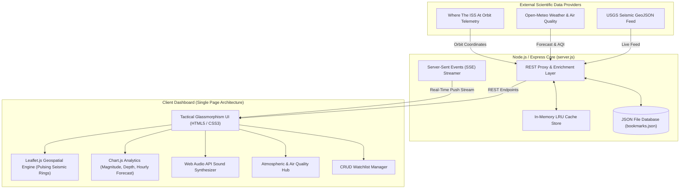

# 🌍 GeoPulse 360: Real-Time Planetary & Climate Intelligence Platform

> **A Full-Stack Web Programming Capstone Project** featuring live geospatial telemetry, real-time seismic incident streaming, global weather and air quality analytics, orbital tracking, and acoustic alerts.

[](https://nodejs.org)
[](https://expressjs.com)
[](https://leafletjs.com)
[](https://www.chartjs.org)
[](LICENSE)

---

## 🌟 Executive Summary

**GeoPulse 360** is a production-grade, full-stack web application designed for environmental scientists, emergency response analysts, and curious citizens. It integrates real-time telemetry from multiple international scientific observation networks into a unified, high-performance command center dashboard.

### 🛰️ Live Real-Time Data Sources (Zero API Keys Required)
1. **USGS (United States Geological Survey)**: Real-time global earthquake feeds updating every few seconds, complete with Richter magnitudes, hypocenter depth, geographic coordinates, and tsunami advisories.
2. **Open-Meteo & WMO**: Real-time atmospheric weather metrics (temperature, humidity, surface pressure, wind vector, feels-like, UV index) and 24-hour / 7-day predictive curves.
3. **Open-Meteo Air Quality Service**: Real-time atmospheric pollutant concentrations (PM2.5, PM10, European AQI, US EPA AQI, Ozone, Nitrogen Dioxide).
4. **Where The ISS At**: Live orbital telemetry of the International Space Station (ISS) calculating real-time coordinates, velocity (~27,600 km/h), and orbital altitude (~420 km).

---

## 📐 System Architecture



---

## 🚀 Key Features

### 1. Interactive Geospatial Command Center (Leaflet.js)
- **Dynamic Pulsing Seismic Rings**: Visualizes every earthquake with SVG rings scaled and color-coded according to Richter magnitude (Green `< M2.5`, Cyan `M2.5-3.9`, Amber `M4.0-4.9`, Red `M5.0-6.4`, Violet `M6.5+`).
- **Live ISS Satellite Tracker**: Real-time orbital marker tracking the space station moving over continents.
- **Multiple Basemaps**: Seamless one-click switching between *CartoDB Dark Matter*, *Esri Satellite Imagery*, and *CartoDB Positron*.
- **Tectonic Plate Boundary Layer**: Visualizes major fault lines including the Pacific Ring of Fire.
- **Epicenter Deep Inspection**: Click any earthquake marker to immediately load meteorological data at the epicenter coordinates.

### 2. Multi-Dimensional Visual Analytics (Chart.js)
- **Magnitude Distribution Histogram**: Aggregates 24-hour seismic events into standard geological classifications.
- **Depth vs. Magnitude Scatter Plot**: Correlates hypocenter depths (shallow crustal vs. deep subduction mantle events).
- **24-Hour Atmospheric Forecast Curve**: Dual-axis line chart tracking temperature variations alongside precipitation probability.

### 3. Server-Sent Events (SSE) & Auto-Refresh Engine
- **Persistent Real-Time Streaming**: Native HTTP EventSource stream (`/api/events/live`) pushing continuous telemetry heartbeats.
- **Configurable Auto-Refresh Countdown**: Interactive timer pill (15s, 30s, 60s, or Pause) with visual countdown badge.
- **Tactical Audio Alerts (Web Audio API)**: Synthesizes acoustic sonar pings and dual-frequency alert sirens for critical events (M5.0+) without relying on external media files.

### 4. Atmospheric & Air Quality Hub
- **Instant Global Search with Auto-Suggest**: Geocoding search debounces user keystrokes to locate any city worldwide.
- **Environmental Health Metrics**: Real-time PM2.5, PM10, and US EPA Air Quality Index ratings with color-coded health warning badges.
- **5-Day Meteorological Outlook**: Daily high/low temperature forecasts with WMO condition iconography.

### 5. Persistent Watchlist & Data Export
- **Saved Observation Stations**: Full CRUD operations to bookmark locations, synchronized both to localStorage and the backend JSON database.
- **One-Click CSV Export**: Downloads complete structured telemetry datasets ready for spreadsheet or GIS import.
- **Executive Print View**: Clean `@media print` stylesheet that strips UI controls and formats the dashboard into an executive reporting layout.

---

## 🛠️ Technology Stack

| Layer | Technologies Used |
| :--- | :--- |
| **Frontend UI** | HTML5 Semantic Elements, Modern CSS3 (Variables, Flexbox, Grid, Glassmorphism, Animations) |
| **Frontend Logic** | Vanilla ES6+ JavaScript (Modular Controller Pattern, Async/Await, Web Audio API) |
| **Mapping Engine** | Leaflet.js v1.9.4, CartoDB & Esri Tile Layers, Custom SVG DivIcons |
| **Data Visualization** | Chart.js v4.4 (Bar, Scatter, Dual-axis Line) |
| **Backend Runtime** | Node.js v20+ & Express v4.21 |
| **Real-Time Channel** | Server-Sent Events (SSE) + In-memory intelligent caching |
| **Persistence** | File-backed JSON Database (`data/bookmarks.json`) + Browser `LocalStorage` |

---

## 📡 REST API Reference

| Method | Endpoint | Description | Query Parameters |
| :--- | :--- | :--- | :--- |
| `GET` | `/api/health` | Service health status and uptime | None |
| `GET` | `/api/earthquakes` | Real-time USGS earthquake feed | `minMag` (float), `limit` (int), `timeframe` (hour/day/week) |
| `GET` | `/api/weather` | Current weather, forecast, and AQI | `lat` (float, required), `lon` (float, required) |
| `GET` | `/api/geocode` | City auto-suggest geocoding | `q` (string, required) |
| `GET` | `/api/iss` | International Space Station telemetry | None |
| `GET` | `/api/stats` | Platform aggregates and summary KPIs | None |
| `GET` | `/api/bookmarks` | List all saved observation stations | None |
| `POST` | `/api/bookmarks` | Save a new observation station | Body: `{ name, latitude, longitude, notes }` |
| `DELETE`| `/api/bookmarks/:id` | Remove a saved station by ID | `:id` (param) |
| `GET` | `/api/export` | Download active seismic dataset | `format` (`csv` or `json`) |
| `GET` | `/api/events/live` | Server-Sent Events live stream | None |

---

## 💻 Installation & Quick Start

### Option 1: One-Click Windows Launcher
Simply double-click the `start.bat` file in the project directory. It will install dependencies if needed, start the server, and open your browser automatically!

### Option 2: Command Line
```bash
# 1. Navigate to the project directory
cd C:\Users\Harish\.gemini\antigravity\scratch\geopulse-live

# 2. Install dependencies
npm install

# 3. Start the application server
npm start
```

Open your browser and navigate to:
```
http://localhost:3000
```

---

## 🎓 Academic / Coursework Rubric Alignment

This project was built to address and exceed standard university Web Programming coursework criteria:

1. **Client-Server Separation**: Clear decoupling between Express API endpoints and client-side presentation.
2. **Real-Time Asynchronous Operations**: Demonstrates `async/await`, `fetch`, Promises, and Server-Sent Events streaming.
3. **Advanced CSS & UI Design**: Built from scratch using modern CSS Custom Properties, Glassmorphism, CSS Grid & Flexbox, smooth transitions, responsive breakpoints, and dark/light themes.
4. **Third-Party API Integration**: Seamless consumption of three heterogeneous public REST and GeoJSON APIs.
5. **Data Visualization**: Interactive graphical interpretations of live physical phenomena with Chart.js.
6. **State & Storage Management**: Dual-layer state persistence combining `localStorage` for client preferences and server JSON persistence for shared bookmarks.
7. **Accessibility & Error Resilience**: Graceful fallbacks for network interruptions, tooltips, responsive mobile scaling, and clean print media styles.
